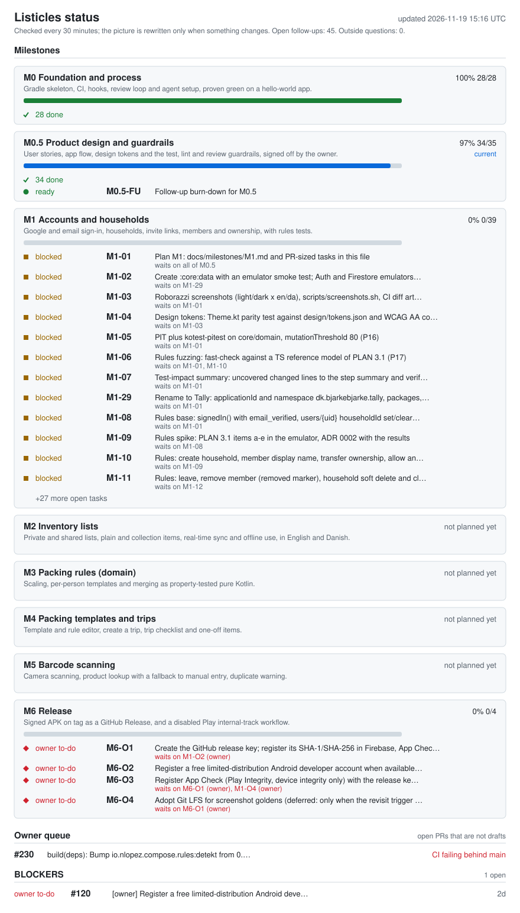

# Listicles

Shared household lists for Android. See docs/PLAN.md for the plan. Run `scripts/verify.sh` to check your changes.

## Status

Each milestone is a card with its name (like "M0.5 Product design and guardrails"), a progress bar and its open tasks,
with what each one waits on; blockers and the owner queue are at the bottom. The full detail (every task with its
dependencies, owner and PR, plus a dependency graph per milestone) is on [the status detail page](https://github.com/bondo/listicles2/blob/status/status.md). Updated by a workflow every 30 minutes and
when issues change or `main` is pushed; how it works and what the markers mean: docs/STATUS.md.
