# Tally app flow (v1)

Status: owner-approved 2026-11-18 (issue #15 comment 6991804241); T2 text size decided (owner, 2026-11-18, issue #15 comment 6991847257) and screen 32a closed (comment 6992107414); recorded in docs/milestones/M1.md section 6.

Task M0.5-02. Status: **owner-approved 2026-11-18** (M0.5-O1, issue #15 comment 6991804241).
Source: the [v1 user stories](stories.md) and the owner decisions they record (Q1-Q5, OQ-1 to OQ-6, OQ-17, OQ-19,
OQ-23 to OQ-33, the two list types; state issue #15). This document adds no product decision: every step names the story it comes from, and anything still
open is marked **OQ-n** as in [stories section 11](stories.md#11-open-questions). New questions this flow raised are in
[section 10](#10-new-open-questions).

## How to read this

* Each box or arrow names the story ids it comes from (`AUTH`, `HH`, `LIST`, `ITEM`, `VIS`, `SYNC`, `LANG`), so
  wireframes (M0.5-03) and later acceptance tests can trace back to [stories.md](stories.md).
* Words are the ones of [stories "How to read this"](stories.md#how-to-read-this): *user*, *household*,
  *household owner*, *list creator*, *private list*, *shared list*, *item*, "I have it".
* Screen names are working names for M0.5-03: **Sign-in** (Google first, then "Use email and password", AUTH-01),
  **Email sign-in** (sign in, create account, reset password: AUTH-05, AUTH-07, AUTH-08), **Verify email** (AUTH-06),
  **Lists** (all lists I can see, LIST-01), **Open list**
  (one list and its items, ITEM-05), **Household** (HH-04), **Join** (HH-03), **Account** (sign out, delete account,
  two-step verification, change password; no language switch, OQ-12).
* A dotted arrow is something that happens later, not a tap. A step marked OQ-n is not decided: the diagram shows
  where the answer plugs in, not the answer. A step marked **proposed** is the planner's recommended answer to an open
  question, drawn so the flow is complete; it changes if the owner decides otherwise.
* Every confirmation can be cancelled, and then nothing changes.
* "Needs a connection" means the step stops with a message when there is no network and leaves nothing half done
  (SYNC-03).

## 1. Screen map

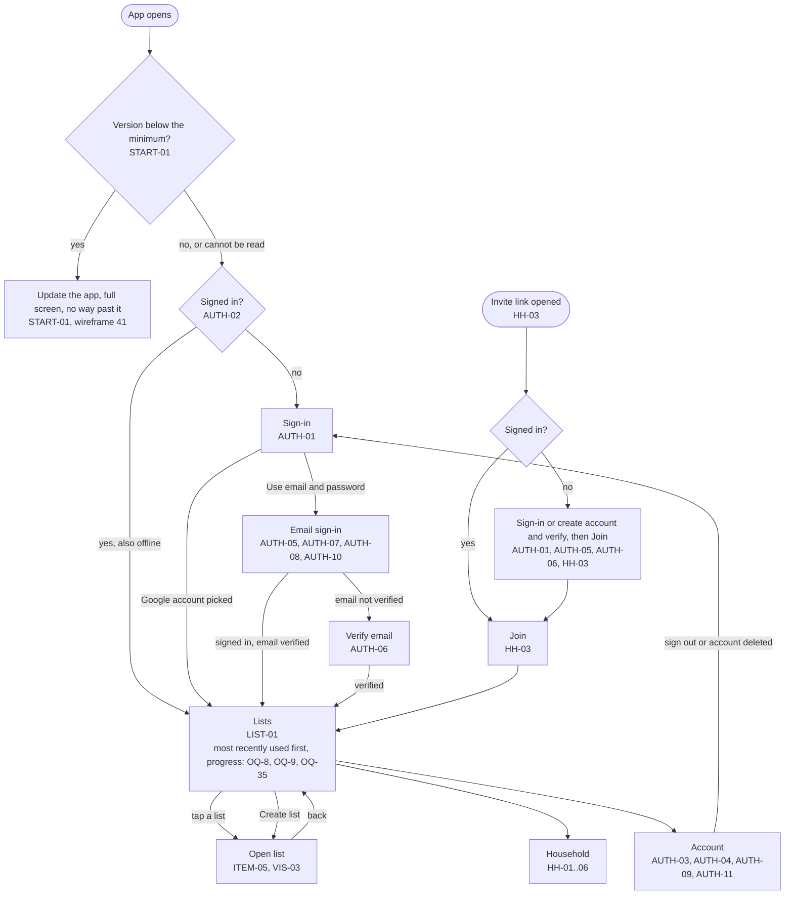

## 2. Sign-in, first use and account

Google is the main button: there is no separate sign-up, the first Google sign-in creates the account (AUTH-01). The
second button, "Use email and password", leads to [section 2.1](#21-email-and-password). A new user can make private
lists at once and needs no household (OQ-1, VIS-01).

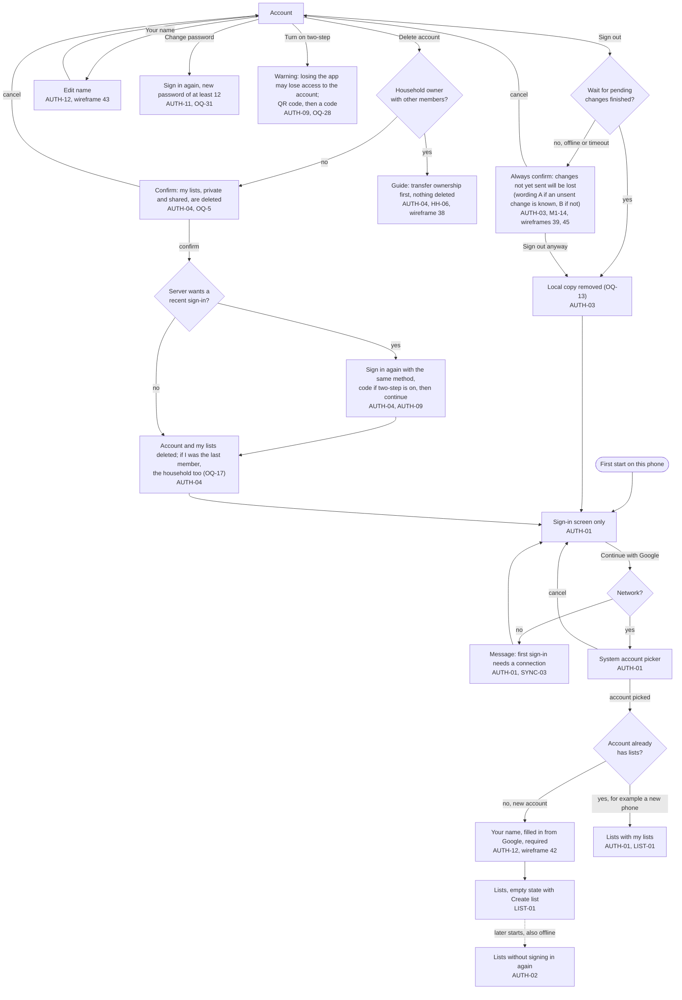

### 2.1 Email and password

Every Firestore read and write needs a verified email (`email_verified`); no rule relies on a two-step claim (stories
section 1). Password: at least 12 characters, no other rules (OQ-26). Each step needs a connection (SYNC-03).

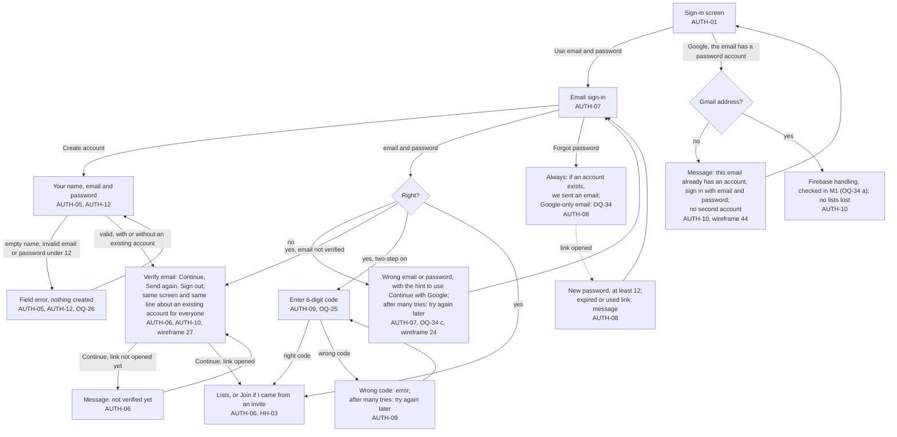

## 3. Household

A household is needed only to share a list (OQ-1). One household per user (HH-01).

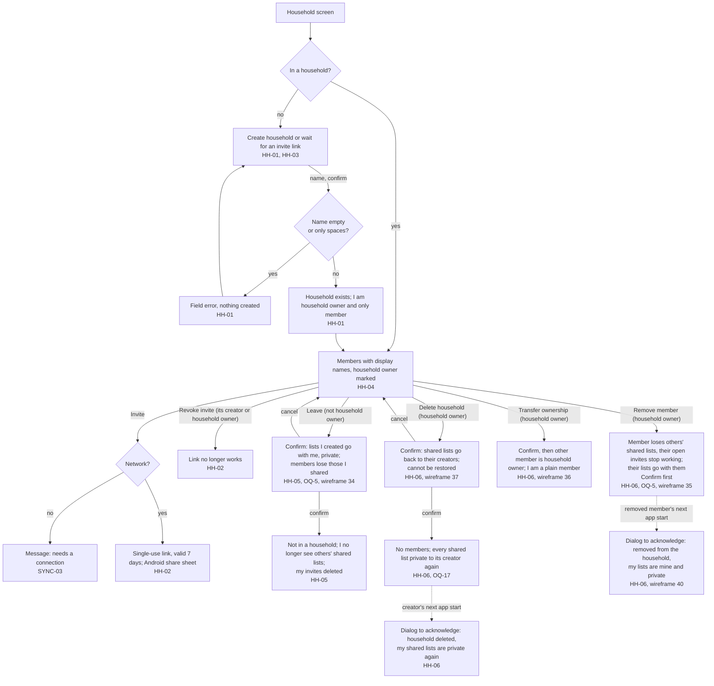

Leaving, removing a member, transferring ownership and deleting the household need a connection
([OQ-22](#10-new-open-questions)).

### Joining with an invite link

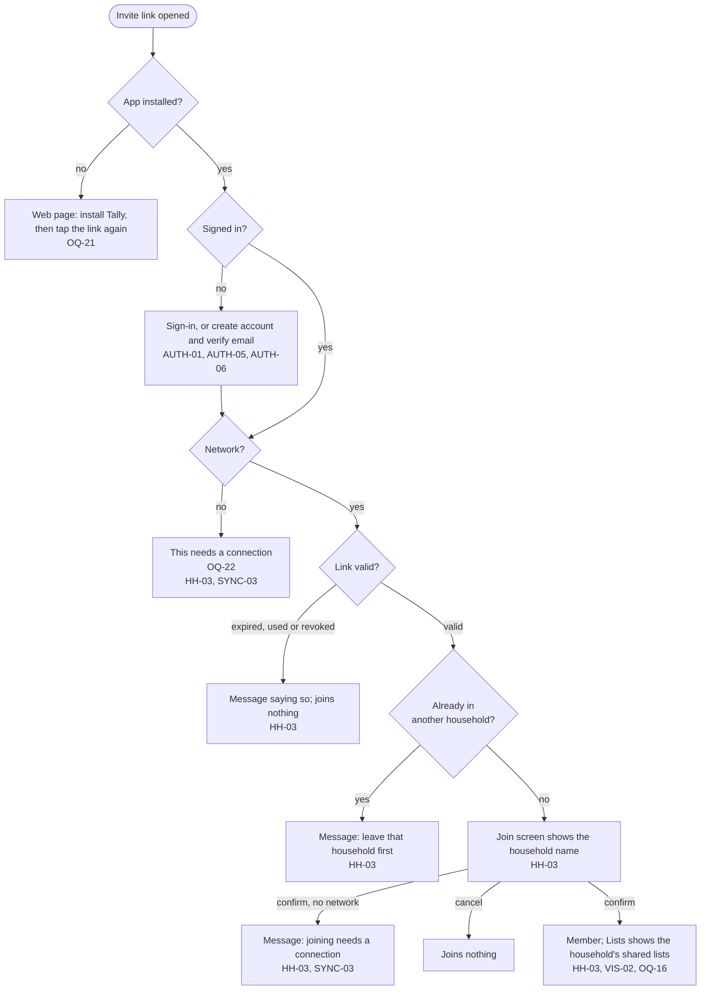

## 4. Lists and private or shared

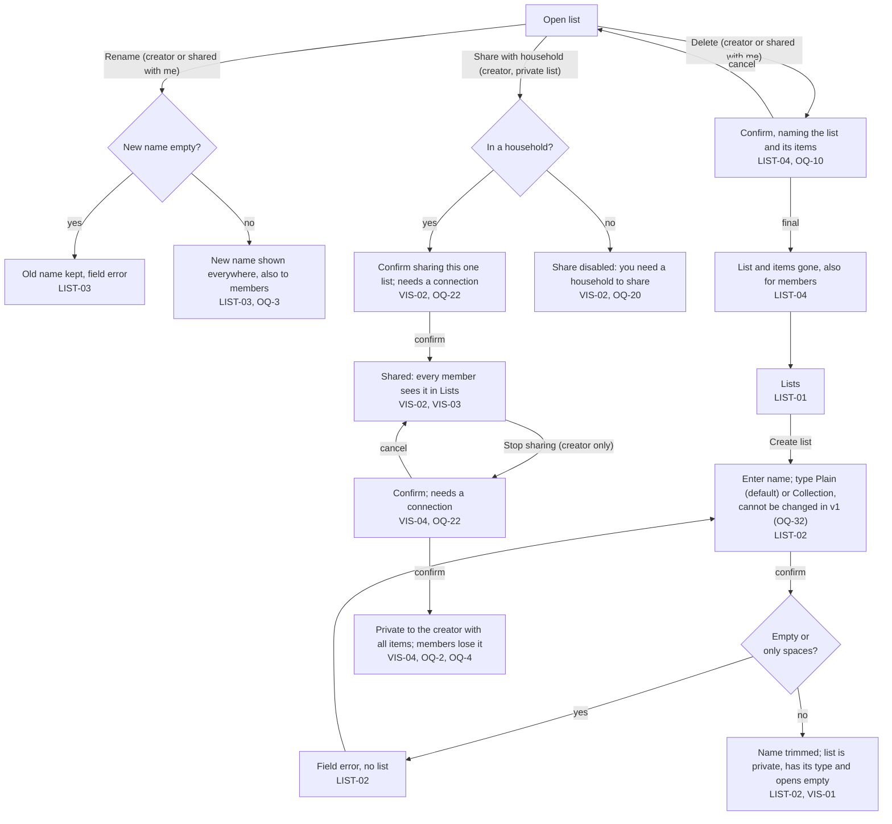

What each person sees and may do on one list (VIS-01 to VIS-04; the server enforces the same, rules allow and deny
tests):

| Who | Private list | Shared list |
|---|---|---|
| List creator | everything | everything, including Stop sharing |
| Other member of the creator's household | not shown, server refuses | everything except Stop sharing and changing creator or household (OQ-2, OQ-3, VIS-04) |
| Anyone else | not shown, server refuses | not shown, server refuses |

## 5. Items

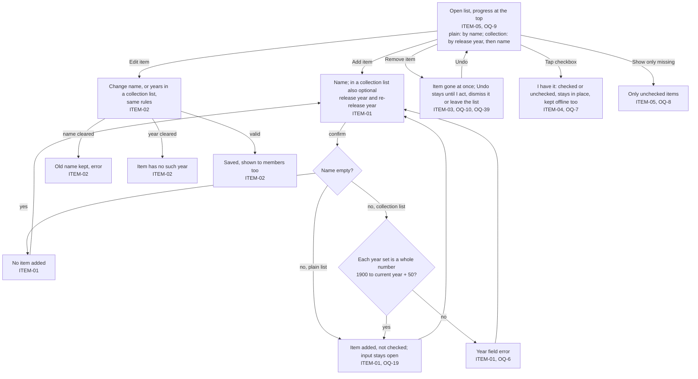

Item order is set by the list type (ITEM-05; items without a release year last, OQ-33). Duplicate item names (OQ-11: allowed, with a quiet hint)
are not in this flow; there is no search or manual order in v1 (OQ-8).

## 6. Offline and sync

The user does nothing to sync (SYNC-01). A small banner shows the offline and waiting states (OQ-14).

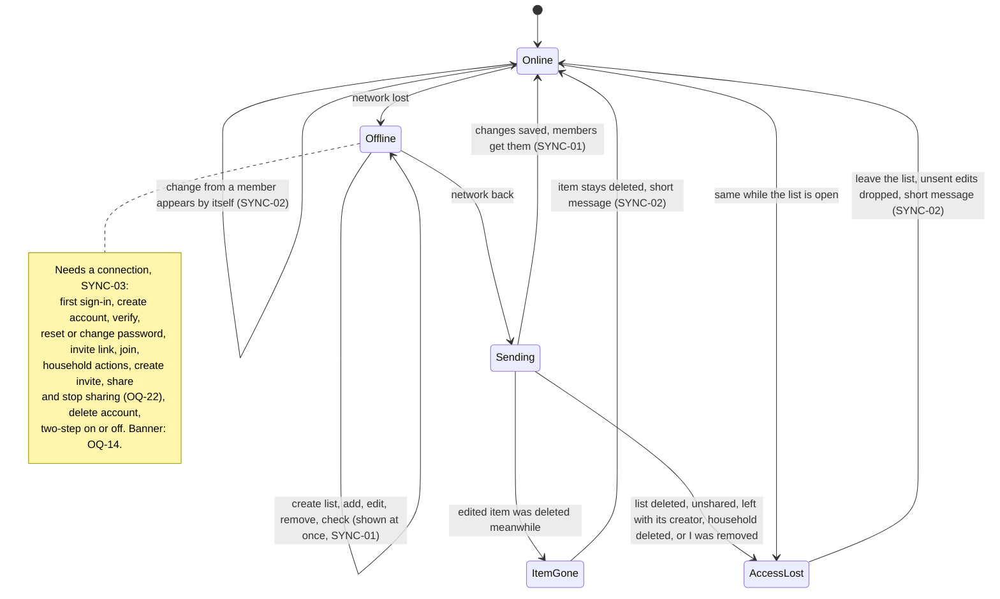

Two members editing the same field: last write wins; different fields are both kept (SYNC-02).

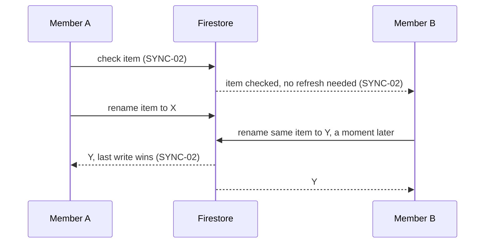

## 7. Language

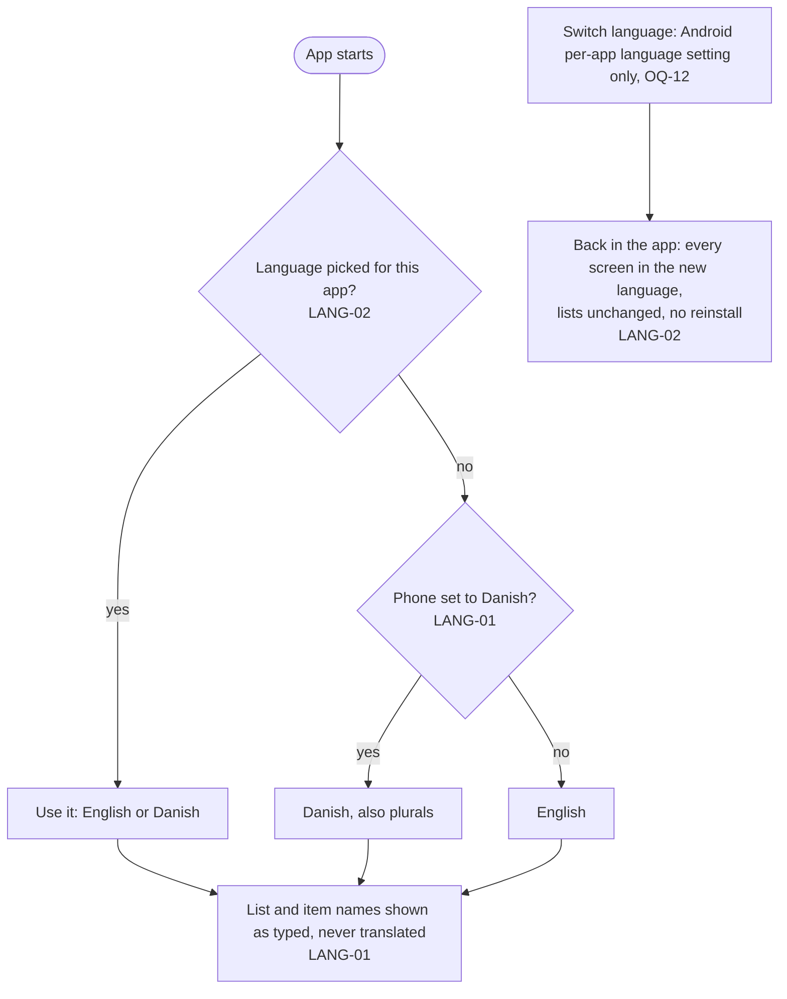

## 8. Empty and error states

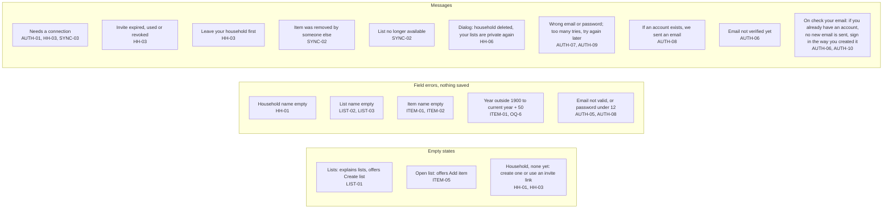

No error is shown when the account picker is cancelled (AUTH-01). Danish text must fit on every screen (LANG-01) and
30 or more items must scroll with nothing cut off (ITEM-05).

## 9. Story coverage

Every v1 story appears in at least one diagram above. Each row lists every story id its section cites.

| Section | Stories |
|---|---|
| 1. Screen map | AUTH-01, AUTH-02, AUTH-03, AUTH-04, AUTH-05, AUTH-06, AUTH-07, AUTH-08, AUTH-09, AUTH-10, AUTH-11, START-01, HH-01, HH-02, HH-03, HH-04, HH-05, HH-06, LIST-01, ITEM-05, VIS-03 |
| 2. Sign-in and account | AUTH-01, AUTH-02, AUTH-03, AUTH-04, AUTH-05, AUTH-06, AUTH-07, AUTH-08, AUTH-09, AUTH-10, AUTH-11, AUTH-12, HH-03, HH-06, LIST-01, VIS-01, SYNC-03 |
| 3. Household | AUTH-01, AUTH-05, AUTH-06, HH-01, HH-02, HH-03, HH-04, HH-05, HH-06, VIS-02, SYNC-03 |
| 4. Lists and sharing | LIST-01, LIST-02, LIST-03, LIST-04, VIS-01, VIS-02, VIS-03, VIS-04 |
| 5. Items | ITEM-01, ITEM-02, ITEM-03, ITEM-04, ITEM-05 |
| 6. Offline and sync | SYNC-01, SYNC-02, SYNC-03 |
| 7. Language | LANG-01, LANG-02 |
| 8. Empty and error states | AUTH-01, AUTH-05, AUTH-06, AUTH-07, AUTH-08, AUTH-09, AUTH-10, HH-01, HH-03, HH-06, LIST-01, LIST-02, LIST-03, ITEM-01, ITEM-02, ITEM-05, SYNC-02, SYNC-03, LANG-01 |

The questions that blocked M0.5-03 (OQ-8, OQ-9, OQ-10, OQ-14, OQ-20) are decided and drawn in sections 1 and 4 to 6.

## 10. New open questions

Found while drawing the flow; all three decided by the owner on 2026-11-16 (issue #15). Ids continue the numbering of
[stories section 11](stories.md#11-open-questions).

| Id | Question | Decision (owner, 2026-11-16) | Stories |
|---|---|---|---|
| OQ-20 | A user who is not in a household taps "Share with household": does the app show a household step (create one with a name, or join with a link) and then share, or create a household for them behind the scenes (OQ-1 leaves this to M1/M2)? | **Decided, differs from the recommendation:** in v1 "Share with household" is disabled with a message; the household step comes after v1. | VIS-02, HH-01 |
| OQ-21 | An invite link opened on a phone without the app: open the Play Store page and ask the person to open the link again after installing? (Firebase Dynamic Links is shut down and there are no Cloud Functions, so the link may not survive the install.) | **Decided:** yes, a simple web page; its hosting and subdomain are an open owner item. | HH-02, HH-03 |
| OQ-22 | Besides first sign-in, joining and creating an invite (SYNC-03): do opening an invite link, leaving, removing a member, transferring ownership, deleting the household, sharing, stopping sharing and deleting the account also need a connection, or may some wait offline and be sent later? | **Decided:** household, invite and sharing actions need a connection ("This needs a connection"); list and item changes work offline. | SYNC-03, HH-03, HH-05, HH-06, VIS-02, VIS-04, AUTH-04 |

Deleting the account and turning two-step verification on or off are not named in the OQ-22 answer; they need a
connection anyway, because the server demands a recent sign-in first (AUTH-04, AUTH-09, SYNC-03).
