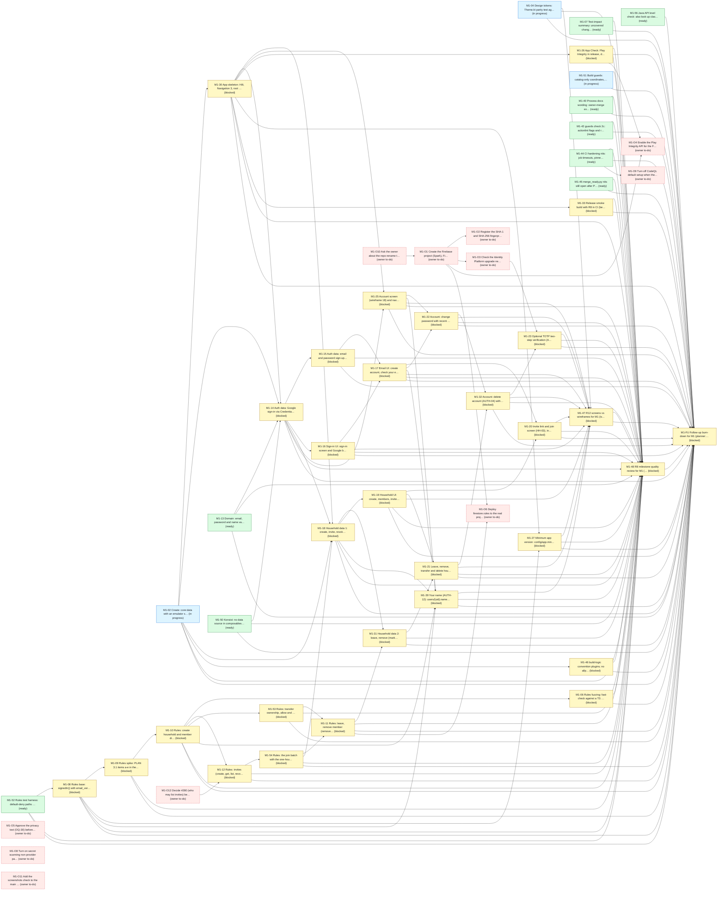
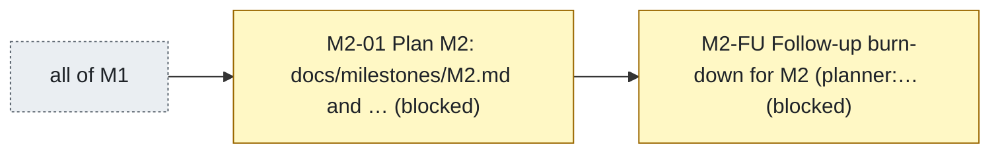
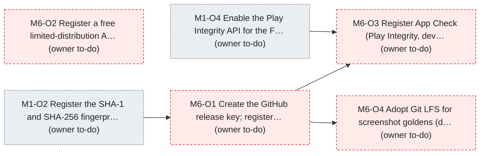

# Listicles status detail

Milestones, their tasks, what each open task waits on, and every blocker, generated from `docs/tasks.toml` and the open PRs and issues. The picture on the front page (`status.svg`) shows the same state. Status words: **done**, **ready** (all dependencies met), **in progress** (an open PR names the task), **blocked** (unmet dependencies or a `blocked` label), **owner to-do** (needs the owner).

## Overview

| Milestone | Name | Done | Open |
|---|---|---|---|
| M0 | Foundation and process | 28/28 (100%) | 0 |
| M0.5 | Product design and guardrails | 35/35 (100%) | 0 |
| M1 | Accounts and households | 16/69 (23%) | 53 |
| M2 | Inventory lists | 0/2 (0%) | 2 |
| M3 | Packing rules (domain) | not planned yet | 0 |
| M4 | Packing templates and trips | not planned yet | 0 |
| M5 | Barcode scanning | not planned yet | 0 |
| M6 | Release | 0/4 (0%) | 4 |

## M0 Foundation and process

Gradle skeleton, CI, hooks, review loop and agent setup, proven green on a hello-world app.

**Progress:** 28/28 done (100%), 0 open.

### Tasks

| Task | Title | Status | Depends on | Who | PR |
|---|---|---|---|---|---|
| M0-01 | Implementation plan (docs/PLAN.md), 4 review rounds | done | none | planner | [#1](https://github.com/bondo/listicles2/issues/1) |
| M0-02 | Gradle skeleton, version catalog, spotless/detekt/lint/Kover | done | M0-01 | implementer | [#1](https://github.com/bondo/listicles2/issues/1) |
| M0-03 | Batch 1&#58; verify/guards/hooks, Firebase emulator + deny tests, CI, Dependabot, PR template, CODEO… | done | M0-02 | implementer | [#1](https://github.com/bondo/listicles2/issues/1) |
| M0-04 | REVIEW.md and CLAUDE.md | done | M0-03 | implementer | [#1](https://github.com/bondo/listicles2/issues/1) |
| M0-05 | Agent setup&#58; roles.yaml, prompts, .claude settings and hooks, status line, handoff template, me… | done | M0-03 | implementer | [#1](https://github.com/bondo/listicles2/issues/1) |
| M0-06 | detekt 2.x vs 1.23 ADR, Kover on &#58;app, dark theme | done | M0-03 | implementer | [#1](https://github.com/bondo/listicles2/issues/1) |
| M0-07 | Prove the gates&#58; CI green on GitHub, a deliberately broken commit fails CI, then revert | done | M0-04, M0-05, M0-06, M0-O1 | implementer | [#1](https://github.com/bondo/listicles2/issues/1) |
| M0-08 | Branch-protection guide for the owner | done | M0-03 | implementer | [#34](https://github.com/bondo/listicles2/issues/34) |
| M0-09 | Orchestration process&#58; docs/ORCHESTRATION.md, state template, task graph + scripts/tasks.py | done | none | process | [#16](https://github.com/bondo/listicles2/issues/16) |
| M0-10 | Tooling session A&#58; run tasks.py and its tests in CI and verify.sh; CODEOWNERS for the process docs | done | none | implementer | [#35](https://github.com/bondo/listicles2/issues/35) |
| M0-11 | Tooling session B&#58; align REVIEW.md, CLAUDE.md, agents/prompts, handoff template with ORCHESTR… | done | M0-04, M0-05, M0-10, M0-12 | implementer | [#80](https://github.com/bondo/listicles2/issues/80) |
| M0-12 | Follow-ups process&#58; docs/FOLLOW-UPS.md, tasks.py follow-up counts and burn-down checks | done | none | process | [#16](https://github.com/bondo/listicles2/issues/16) |
| M0-13 | Process and tooling review (#20)&#58; written review in docs/, prioritised proposals with effort an… | done | none | process | [#33](https://github.com/bondo/listicles2/issues/33) |
| M0-14 | Turn the proposals the owner adopts (M0-O11) into PR-sized tasks with dependencies; open follow… | done | M0-13, M0-O11 | planner | [#37](https://github.com/bondo/listicles2/issues/37) |
| M0-15 | Lower the big-pr diff cap in ci.yml from 6000 to 1500 (D2) | done | M0-O11 | implementer | [#36](https://github.com/bondo/listicles2/issues/36) |
| M0-16 | Close follow-ups #21-#26 as by-design once branch protection is confirmed on (D1) | done | M0-O6 | process |  |
| M0-FU | Follow-up burn-down for M0 (close or re-defer each open follow-up targeting M0) | done | M0-01, M0-02, M0-03, M0-04, M0-05, M0-06, M0-07, M0-08, M0-09, M0-10, M0-11, M0-12, M0-13, M0-14, M0-15, M0-16 | implementer |  |
| M0-O1 | Add the big-pr label to PR #1 | done | none | owner |  |
| M0-O2 | Set the default branch to main | done | none | owner |  |
| M0-O3 | Make the repository public | done | none | owner |  |
| M0-O4 | Confirm the CODEOWNERS handle | done | M0-03 | owner |  |
| M0-O5 | Decide how the orchestration branch lands (merge into the PR #1 branch or a separate PR) | done | none | owner |  |
| M0-O6 | Turn on branch protection for main using the guide | done | M0-08, M0-O2 | owner |  |
| M0-O10 | Create the follow-up labels (follow-up, severity&#58;*, target&#58;*, area&#58;*, owner-ok) | done | none | owner |  |
| M0-O7 | Squash-merge PR #1 (M0) | done | M0-04, M0-05, M0-06, M0-07, M0-08, M0-O1, M0-O4, M0-O5 | owner | [#1](https://github.com/bondo/listicles2/issues/1) |
| M0-O8 | Retarget PR #16 to main after #1 merges, then squash-merge it | done | M0-O7, M0-09, M0-10, M0-11, M0-12, M0-FU | owner | [#16](https://github.com/bondo/listicles2/issues/16) |
| M0-O11 | Decide which proposals from the #20 process and tooling review to adopt | done | M0-13 | owner |  |
| M0-O9 | Create the GitHub labels orchestrator-state and owner-todo | done | none | owner |  |

### Open tasks and what blocks them

Nothing open.

## M0.5 Product design and guardrails

User stories, app flow, design tokens and the test, lint and review guardrails, signed off by the owner.

**Progress:** 35/35 done (100%), 0 open.

### Tasks

| Task | Title | Status | Depends on | Who | PR |
|---|---|---|---|---|---|
| M0.5-01 | User stories with acceptance criteria (docs/product/stories.md) | done | all of M0 | planner | [#94](https://github.com/bondo/listicles2/issues/94) |
| M0.5-02 | App-flow diagram (docs/product/flow.md, Mermaid) | done | M0.5-01 | planner | [#103](https://github.com/bondo/listicles2/issues/103) |
| M0.5-03 | Screen wireframes and design tokens (colors, type, spacing, dark mode) as an artifact | done | M0.5-01, M0.5-16 | planner | [#113](https://github.com/bondo/listicles2/issues/113) |
| M0.5-04 | App and repo name shortlist (#17)&#58; 5-8 candidates with Play Store, GitHub and domain availabilit… | done | all of M0 | planner | [#77](https://github.com/bondo/listicles2/issues/77) |
| M0.5-05 | guards.sh&#58; suppressions of new linters (noqa, type&#58; ignore, eslint-disable, &#64;ts-*, coverage, for… | done | M0-O11 | implementer | [#43](https://github.com/bondo/listicles2/issues/43) |
| M0.5-06 | CI&#58; shellcheck, actionlint, zizmor; SHA-pin actions; persist-credentials false (P2) | done | M0.5-05 | implementer | [#102](https://github.com/bondo/listicles2/issues/102) |
| M0.5-07 | ruff check (E,F,W,B,UP,SIM) and mypy (default) for scripts/, in verify.sh and CI (P3) | done | M0.5-05, M0-10 | implementer | [#79](https://github.com/bondo/listicles2/issues/79) |
| M0.5-08 | Firebase rules tests to strict TypeScript, ESLint strictTypeChecked and Prettier (P4, P5) | done | M0.5-05 | implementer | [#96](https://github.com/bondo/listicles2/issues/96) |
| M0.5-09 | Kotlin allWarningsAsErrors in all modules (P6) | done | M0-O11 | implementer | [#47](https://github.com/bondo/listicles2/issues/47) |
| M0.5-10 | licensee with the owner's allowlist (P8, D3)&#58; Apache-2.0, MIT, BSD-2-Clause, BSD-3-Clause; Goog… | done | M0.5-09 | implementer | [#84](https://github.com/bondo/listicles2/issues/84) |
| M0.5-11 | Konsist&#58; no floating point in core/domain, no raw colors/dp in UI; network-blocking JUnit extens… | done | M0-O11 | implementer | [#59](https://github.com/bondo/listicles2/issues/59) |
| M0.5-12 | Docs check&#58; relative links and backticked repo paths exist, planned paths allowlisted (P12) | done | M0.5-05, M0-11 | implementer | [#78](https://github.com/bondo/listicles2/issues/78) |
| M0.5-13 | Metrics&#58; orchestrator CSV comments per ORCHESTRATION 6 and scripts/agent_metrics.py to docs/age… | done | M0-O11 | implementer | [#58](https://github.com/bondo/listicles2/issues/58) |
| M0.5-14 | ORCHESTRATION.md retro changes&#58; delta review, one batch per PR, env pick, default deferral, early… | done | M0-O11 | process | [#41](https://github.com/bondo/listicles2/issues/41) |
| M0.5-15 | Prompts&#58; design-reviewer role and checklist, PR-body refresh, delta review, environment pick (P… | done | M0-11, M0.5-14, M0.5-23 | implementer | [#83](https://github.com/bondo/listicles2/issues/83) |
| M0.5-FU | Follow-up burn-down for M0.5 | done | M0.5-01, M0.5-02, M0.5-03, M0.5-04, M0.5-05, M0.5-06, M0.5-07, M0.5-08, M0.5-09, M0.5-10, M0.5-11, M0.5-12, M0.5-13, M0.5-14, M0.5-15, M0.5-16, M0.5-17, M0.5-18, M0.5-19, M0.5-20, M0.5-21, M0.5-22, M0.5-23, M0.5-24, M0.5-25, M0.5-26, M0.5-27, M0.5-28, M0.5-29 | implementer |  |
| M0.5-27 | Status picture on the README&#58; scripts render docs/tasks.toml plus PR and issue state to an SVG, a… | done | none | implementer | [#71](https://github.com/bondo/listicles2/issues/71) |
| M0.5-O1 | Approve stories, flow and design | done | M0.5-01, M0.5-02, M0.5-03 | owner |  |
| M0.5-O2 | Pick the app and repo name from the shortlist | done | M0.5-04 | owner | [#77](https://github.com/bondo/listicles2/issues/77) |
| M0.5-O3 | Log collaborator decisions D1-D7, create the five labels, check Actions settings (C5) | done | none | owner |  |
| M0.5-16 | COLLABORATING.md plus ORCHESTRATION, PLAN and orchestrator-state changes for the collaborator | done | M0.5-O3 | process | [#55](https://github.com/bondo/listicles2/issues/55) |
| M0.5-17 | Issue forms for feedback, ideas and questions, with a test that parses them | done | M0.5-O3 | implementer | [#56](https://github.com/bondo/listicles2/issues/56) |
| M0.5-18 | scripts/collab_inbox.py&#58; digest of trusted collaborator activity since a time, from saved API JSON | done | M0.5-17 | implementer | [#64](https://github.com/bondo/listicles2/issues/64) |
| M0.5-19 | Orchestrator and worker prompts&#58; inbox and accident-check wake steps, tiers, fenced text, label … | done | M0.5-16, M0.5-18 | implementer | [#67](https://github.com/bondo/listicles2/issues/67) |
| M0.5-20 | docs/ANDROID-BEST-PRACTICES.md&#58; checklist from Google's Android guidance, enforced vs reviewer-c… | done | none | process | [#62](https://github.com/bondo/listicles2/issues/62) |
| M0.5-21 | Usage-limit handling&#58; ORCHESTRATION pause protocol, early warning, limit failures are not stalls… | done | M0.5-13 | process | [#63](https://github.com/bondo/listicles2/issues/63) |
| M0.5-22 | CLAUDE.md&#58; allow one reviewer session to review several small docs-only PRs (the pending bulle… | done | M0.5-21 | implementer | [#93](https://github.com/bondo/listicles2/issues/93) |
| M0.5-23 | docs/reviews/README.md&#58; review catalogue R1-R12, procedures, visual-quality rubric, meta-revie… | done | M0.5-21 | implementer | [#72](https://github.com/bondo/listicles2/issues/72) |
| M0.5-24 | scripts/agent_metrics.py&#58; &#96;review&#96; row type (ledger of docs/reviews/README.md section 5), fai… | done | M0.5-23 | implementer | [#73](https://github.com/bondo/listicles2/issues/73) |
| M0.5-25 | Orchestrator prompt&#58; R3 weekly digest step, ledger row after each review, R10 owner-todo per … | done | M0.5-19, M0.5-21, M0.5-23 | implementer | [#74](https://github.com/bondo/listicles2/issues/74) |
| M0.5-26 | REVIEW.md&#58; R9 visual-rubric item (agent score below 3 is a minor finding) and R7 rules allow/… | done | M0.5-03, M0.5-15, M0.5-23 | implementer | [#133](https://github.com/bondo/listicles2/issues/133) |
| M0.5-O4 | Collaborator invite sent and accepted | done | M0.5-19, M0.5-O3 | owner |  |
| M0.5-O5 | Confirm the collaborator's 2FA and run the live test | done | M0.5-O4 | owner |  |
| M0.5-28 | R6 retro of M0.5&#58; compare the Agent Usage Redesign pilot with its baseline and propose at most … | done | M0.5-01, M0.5-02, M0.5-03, M0.5-04, M0.5-05, M0.5-06, M0.5-07, M0.5-08, M0.5-09, M0.5-10, M0.5-11, M0.5-12, M0.5-13, M0.5-14, M0.5-15, M0.5-27, M0.5-16, M0.5-17, M0.5-18, M0.5-19, M0.5-20, M0.5-21, M0.5-22, M0.5-23, M0.5-24, M0.5-25, M0.5-26, M0.5-29 | retro | [#137](https://github.com/bondo/listicles2/issues/137) |
| M0.5-29 | File-size guard in scripts/guards.sh&#58; an added or changed file over 1 MB, or a PNG over 300 KB out… | done | none | implementer | [#141](https://github.com/bondo/listicles2/issues/141) |

### Open tasks and what blocks them

Nothing open.

## M1 Accounts and households

Google and email sign-in, households, invite links, members and ownership, with rules tests.

**Progress:** 16/69 done (23%), 53 open.

### Tasks

| Task | Title | Status | Depends on | Who | PR |
|---|---|---|---|---|---|
| M1-01 | Plan M1&#58; docs/milestones/M1.md and PR-sized tasks in this file | done | all of M0.5 | planner | [#124](https://github.com/bondo/listicles2/issues/124) |
| M1-02 | Create &#58;core&#58;data with an emulator smoke test; Auth and Firestore emulators in CI (firebase.jso… | in progress | M1-29 | implementer | [#294](https://github.com/bondo/listicles2/issues/294) |
| M1-03 | Roborazzi screenshots (light/dark x en/da), scripts/screenshots.sh, CI diff artifact, ATF and enabl… | done | M1-01 | implementer |  |
| M1-04 | Design tokens&#58; Theme.kt parity test against design/tokens.json and WCAG AA contrast test (P22) | in progress | M0.5-03, M1-03 | implementer | [#295](https://github.com/bondo/listicles2/issues/295) |
| M1-05 | PIT plus kotest-pitest on core/domain, mutationThreshold 80 (P16) | done | M1-01 | implementer |  |
| M1-06 | Rules fuzzing&#58; fast-check against a TS reference model of PLAN 3.1 (P17) | blocked | M1-01, M0.5-08, M1-10 | implementer |  |
| M1-07 | Test-impact summary&#58; uncovered changed lines to the step summary and verify.sh (P19) | ready | M1-01 | implementer |  |
| M1-29 | Rename to Tally&#58; applicationId and namespace dk.bjarkebjarke.tally, packages, app label en/da | done | M1-01 | implementer | [#268](https://github.com/bondo/listicles2/issues/268) |
| M1-08 | Rules base&#58; signedIn() with email_verified, users/{uid} householdId set/clear and name, tombsto… | blocked | M1-52 | implementer |  |
| M1-09 | Rules spike&#58; PLAN 3.1 items a-e in the emulator, ADR 0002 with the results | blocked | M1-08 | implementer |  |
| M1-10 | Rules&#58; create household and member display name, allow and deny tests (transfer is M1-53) | blocked | M1-09 | implementer |  |
| M1-11 | Rules&#58; leave, remove member (removed marker), household soft delete and cleanup, allow and de… | blocked | M1-54, M1-53 | implementer |  |
| M1-12 | Rules&#58; invites (create, get, list, revoke, cleanup), incl. unverified get denied (join is M1-54) | blocked | M1-10, M1-O12 | implementer |  |
| M1-30 | App skeleton&#58; Hilt, Navigation 3, root with the start-up gates, M1 home, connectivity helper, Go… | blocked | M1-29, M1-02, M1-36, M1-49 | implementer |  |
| M1-13 | Domain&#58; email, password and name validation (12+ code points, name 1-50), property tests | ready | M1-37 | implementer |  |
| M1-14 | Auth data&#58; Google sign-in via Credential Manager, session state, sign out (Auth emulator) | blocked | M1-30, M1-13, M1-02, M1-50 | implementer |  |
| M1-15 | Auth data&#58; email and password sign-up, sign-in, verification, reset, error mapping, collision m… | blocked | M1-14 | implementer |  |
| M1-16 | Sign-in UI&#58; sign-in screen and Google button (AUTH-01, AUTH-02; sign-out UI is M1-25) | blocked | M1-14, M1-03, M1-49 | implementer |  |
| M1-17 | Email UI&#58; create account, check your email, sign in, reset (AUTH-05..08, AUTH-10) | blocked | M1-15, M1-16 | implementer |  |
| M1-24 | LocaleConfig&#58; generateLocaleConfig and resources.properties (LANG-02) | done | M1-29 | implementer | [#287](https://github.com/bondo/listicles2/issues/287) |
| M1-18 | Household data 1&#58; create, invite, revoke, join, start-up self-heal (emulator) | blocked | M1-54, M1-14, M1-30, M1-02 | implementer |  |
| M1-31 | Household data 2&#58; leave, remove (marker, resumable), transfer, delete with cleanup resume (em… | blocked | M1-11, M1-18 | implementer |  |
| M1-19 | Household UI&#58; create, members, invite share sheet, revoke (HH-01, HH-02, HH-04) | blocked | M1-18 | implementer |  |
| M1-20 | Invite link and join screen (HH-03), incl. signed-out routing through sign-in | blocked | M1-19, M1-17 | implementer |  |
| M1-21 | Leave, remove, transfer and delete household UI, household-deleted dialog (HH-05, HH-06) | blocked | M1-19, M1-31 | implementer |  |
| M1-22 | Account&#58; change password with recent sign-in (AUTH-11) | blocked | M1-17, M1-25 | implementer |  |
| M1-32 | Account&#58; delete account (AUTH-04) with recent sign-in, resumable | blocked | M1-22, M1-21 | implementer |  |
| M1-23 | Optional TOTP two-step verification (AUTH-09) | blocked | M1-32, M1-O3 | implementer |  |
| M1-25 | Account screen (wireframe 18) and navigation&#58; sign-out UI (AUTH-03), Crashlytics opt-in switch, … | blocked | M1-30, M1-14 | implementer |  |
| M1-26 | App Check&#58; Play Integrity in release, debug provider in debug builds (not enforced) | blocked | M1-30 | implementer |  |
| M1-27 | Minimum app version&#58; config/app.minVersionCode, schemaVersion, update screen | blocked | M1-08, M1-30 | implementer |  |
| M1-28 | Privacy text draft in English and Danish (OQ-30) | done | M1-01 | planner | [#286](https://github.com/bondo/listicles2/issues/286) |
| M1-33 | Release smoke build with R8 in CI (best-practices checklist follow-up 7) | blocked | M1-30 | implementer |  |
| M1-52 | Rules test harness&#58; default-deny paths from PLAN section 3, list and collection-group queries, unv… | ready | M1-35 | implementer |  |
| M1-53 | Rules&#58; transfer ownership, allow and deny tests (partial transfers, plain member, non-member) | blocked | M1-10 | implementer |  |
| M1-54 | Rules&#58; the join batch with the one-household check, allow and deny tests | blocked | M1-12 | implementer |  |
| M1-55 | Tooling&#58; move the androidTest ListiclesAppTest into the tally package as TallyAppTest and update t… | done | M1-29 | implementer |  |
| M1-49 | detekt LongParameterList&#58; ignoreAnnotated &#91;Composable&#93; for that rule only (issue 217 item 5) | done | M1-01 | implementer | [#236](https://github.com/bondo/listicles2/issues/236) |
| M1-56 | Java API level check&#58; also look up classes used only as class literals, annotations, checkcast, ins… | ready | M1-37 | implementer |  |
| M1-50 | Konsist&#58; no data source in composables or ViewModels, no GlobalScope (checklist proposed follow… | ready | M1-01 | implementer |  |
| M1-51 | Build guards&#58; catalog-only coordinates, targetSdk floor, manifest cleartext and backup (checklist … | in progress | M1-01 | implementer | [#296](https://github.com/bondo/listicles2/issues/296) |
| M1-35 | PLAN amendments from the follow-up triage (P1-P9 rules and users name, quota risk, PIT 80, ui … | done | M1-01 | planner | [#265](https://github.com/bondo/listicles2/issues/265) |
| M1-36 | Product docs&#58; start-up gates, M1 home, AUTH-06 wording, design status (owner answers Q1 A, Q2 … | done | M1-O7 | planner |  |
| M1-37 | JVM modules&#58; check Java API use against minSdk 26 with api-versions.xml (issue 228) | done | M1-01 | implementer | [#288](https://github.com/bondo/listicles2/issues/288) |
| M1-38 | Run the licensee and warnings gate self-tests only when their inputs change; licensee version as … | done | M1-01 | implementer |  |
| M1-39 | Your name (AUTH-12)&#58; users/{uid}.name, name step at first Google sign-in and at start, edit in A… | blocked | M1-08, M1-10, M1-18, M1-17, M1-25 | implementer |  |
| M1-40 | Process docs wording&#58; owner-merge exceptions next to the merge-agent rule (issue 147), dispatch… | ready | M1-01 | implementer |  |
| M1-41 | check_gradle_repos.py&#58; dotted repositories.google(), raw strings and nested templates (issues 226… | done | M1-01 | implementer |  |
| M1-42 | guards check 2c&#58; actionlint flags and ruff --fix/--target-version, deferred nits (issues 164, 174) | ready | M1-01 | implementer |  |
| M1-43 | prompt_rules.py&#58; sentence-level negation for the resolve-thread rule (issue 153) | done | M1-01 | implementer |  |
| M1-44 | CI hardening nits&#58; job timeouts, pinned python and node, gitleaks download, npm install scripts,… | ready | M1-01 | implementer |  |
| M1-45 | merge_ready.py nits still open after PRs 248 and 245 (issue 148) | ready | M1-01 | implementer |  |
| M1-46 | build-logic convention plugins; no allprojects or subprojects configuration (issues 217 items 1-4,… | blocked | M1-02 | implementer |  |
| M1-47 | R12 screens vs wireframes for M1 (issue 65 review catalogue) | blocked | M1-16, M1-17, M1-19, M1-20, M1-21, M1-22, M1-23, M1-25, M1-27, M1-32, M1-39, M1-03, M1-04 | process |  |
| M1-48 | R8 milestone quality review for M1 (issue 65 review catalogue) | blocked | M1-02, M1-03, M1-04, M1-05, M1-06, M1-07, M1-08, M1-09, M1-10, M1-11, M1-12, M1-13, M1-14, M1-15, M1-16, M1-17, M1-18, M1-19, M1-20, M1-21, M1-22, M1-23, M1-24, M1-25, M1-26, M1-27, M1-28, M1-29, M1-30, M1-31, M1-32, M1-33, M1-35, M1-36, M1-37, M1-38, M1-39, M1-40, M1-41, M1-42, M1-43, M1-44, M1-45, M1-46, M1-47, M1-49, M1-50, M1-51, M1-52, M1-53, M1-54 | process |  |
| M1-34 | guards.sh&#58; compare line length per tool across all style files, with ruff and flake8 defaults (is… | done | none | implementer |  |
| M1-FU | Follow-up burn-down for M1 (planner&#58; add each new M1 task to depends_on) | blocked | M1-01, M1-02, M1-03, M1-04, M1-05, M1-06, M1-07, M1-08, M1-09, M1-10, M1-11, M1-12, M1-13, M1-14, M1-15, M1-16, M1-17, M1-18, M1-19, M1-20, M1-21, M1-22, M1-23, M1-24, M1-25, M1-26, M1-27, M1-28, M1-29, M1-30, M1-31, M1-32, M1-33, M1-34, M1-35, M1-36, M1-37, M1-38, M1-39, M1-40, M1-41, M1-42, M1-43, M1-44, M1-45, M1-46, M1-47, M1-48, M1-49, M1-50, M1-51, M1-52, M1-53, M1-54, M1-55, M1-56 | implementer |  |
| M1-O1 | Create the Firebase project (Spark), Firestore in eur3, Google and email sign-in, google-services.… | owner to-do | all of M0, M0.5-O2, M1-29, M1-O10 | owner |  |
| M1-O2 | Register the SHA-1 and SHA-256 fingerprints of the debug key in Firebase (Google sign-in) | owner to-do | M1-O1 | owner |  |
| M1-O3 | Check the Identity Platform upgrade needs no billing (OQ-25); if so, upgrade and enable TOTP via R… | owner to-do | M1-O1 | owner |  |
| M1-O4 | Enable the Play Integrity API for the Firebase project in the Google Cloud console | owner to-do | M1-O1, M1-26 | owner |  |
| M1-O5 | Approve the privacy text (OQ-30) before anyone but the owner installs the app | owner to-do | M1-28 | owner |  |
| M1-O6 | Deploy firestore.rules to the real project after each merged rules PR and before each tester build | owner to-do | M1-O1, M1-11 | owner |  |
| M1-O7 | Answer the M1 planning questions Q1-Q7 (docs/milestones/M1.md section 6.1) | done | none | owner |  |
| M1-O8 | Turn on secret scanning non-provider patterns and validity checks (repo settings) | owner to-do | none | owner |  |
| M1-O9 | Turn off CodeQL default setup when the advanced workflow of M1-44 merges | owner to-do | M1-44 | owner |  |
| M1-O10 | Ask the owner about the repo rename to Tally (right before M1-O1) | owner to-do | M1-29 | owner |  |
| M1-O11 | Add the screenshots check to the main ruleset required list (M1-03 added the job; docs list it as… | owner to-do | M1-03 | owner |  |
| M1-O12 | Decide #280 (who may list invites) before M1-12 starts | owner to-do | none | owner |  |

### Open tasks and what blocks them

An arrow points from what a task waits on to the task. Dashed grey boxes are outside this milestone.

## M2 Inventory lists

Private and shared lists, plain and collection items, real-time sync and offline use, in English and Danish.

**Progress:** 0/2 done (0%), 2 open.

### Tasks

| Task | Title | Status | Depends on | Who | PR |
|---|---|---|---|---|---|
| M2-01 | Plan M2&#58; docs/milestones/M2.md and PR-sized tasks in this file | blocked | all of M1 | planner |  |
| M2-FU | Follow-up burn-down for M2 (planner&#58; add each new M2 task to depends_on) | blocked | M2-01 | implementer |  |

### Open tasks and what blocks them

An arrow points from what a task waits on to the task. Dashed grey boxes are outside this milestone.

## M3 Packing rules (domain)

(After v1.) Scaling, per-person templates and merging as property-tested pure Kotlin.

Not planned yet.

## M4 Packing templates and trips

(After v1.) Template and rule editor, create a trip, trip checklist and one-off items.

Not planned yet.

## M5 Barcode scanning

(After v1.) Camera scanning, product lookup with a fallback to manual entry, duplicate warning.

Not planned yet.

## M6 Release

Signed APK on tag as a GitHub Release, and a disabled Play internal-track workflow.

**Progress:** 0/4 done (0%), 4 open.

### Tasks

| Task | Title | Status | Depends on | Who | PR |
|---|---|---|---|---|---|
| M6-O1 | Create the GitHub release key; register its SHA-1/SHA-256 in Firebase, App Check and assetlinks.json | owner to-do | M1-O2 | owner |  |
| M6-O2 | Register a free limited-distribution Android developer account when available in Denmark | owner to-do | none | owner |  |
| M6-O3 | Register App Check (Play Integrity, device integrity only) with the release key; watch metrics t… | owner to-do | M6-O1, M1-O4 | owner |  |
| M6-O4 | Adopt Git LFS for screenshot goldens (deferred&#58; only when the revisit trigger fires) | owner to-do | M6-O1 | owner |  |

### Open tasks and what blocks them

An arrow points from what a task waits on to the task. Dashed grey boxes are outside this milestone.

## Blockers

- **owner to-do** [#120](https://github.com/bondo/listicles2/issues/120): &#91;owner&#93; Register a free limited-distribution Android developer account when available in Denmark
- **owner to-do** [#285](https://github.com/bondo/listicles2/issues/285): &#91;owner&#93; M1-O12&#58; Decide #280 (who may list invites) before M1-12 starts
- **owner to-do** [#289](https://github.com/bondo/listicles2/issues/289): &#91;owner&#93; M1-O11&#58; Add the screenshots check to the main ruleset required list
- **owner to-do** [#291](https://github.com/bondo/listicles2/issues/291): &#91;owner&#93; M1-O5&#58; Approve the privacy text (OQ-30) before anyone but the owner installs the app
- **PR to merge** [#296](https://github.com/bondo/listicles2/issues/296): M1-51&#58; build guard for the targetSdk floor (see #257)
- **task** M1-06: waits on M1-10
- **task** M1-08: waits on M1-52
- **task** M1-09: waits on M1-08
- **task** M1-10: waits on M1-09
- **task** M1-11: waits on M1-54, M1-53
- **task** M1-12: waits on M1-10, M1-O12
- **task** M1-30: waits on M1-02
- **task** M1-14: waits on M1-30, M1-13, M1-02 +1
- **task** M1-15: waits on M1-14
- **task** M1-16: waits on M1-14
- **task** M1-17: waits on M1-15, M1-16
- **task** M1-18: waits on M1-54, M1-14, M1-30 +1
- **task** M1-31: waits on M1-11, M1-18
- **task** M1-19: waits on M1-18
- **task** M1-20: waits on M1-19, M1-17
- **task** M1-21: waits on M1-19, M1-31
- **task** M1-22: waits on M1-17, M1-25
- **task** M1-32: waits on M1-22, M1-21
- **task** M1-23: waits on M1-32, M1-O3
- **task** M1-25: waits on M1-30, M1-14
- **task** M1-26: waits on M1-30
- **task** M1-27: waits on M1-08, M1-30
- **task** M1-33: waits on M1-30
- **task** M1-53: waits on M1-10
- **task** M1-54: waits on M1-12
- **task** M1-39: waits on M1-08, M1-10, M1-18 +2
- **task** M1-46: waits on M1-02
- **task** M1-47: waits on M1-16, M1-17, M1-19 +9
- **task** M1-48: waits on M1-02, M1-04, M1-06 +36
- **task** M1-FU: waits on M1-02, M1-04, M1-06 +38
- **task** M1-O1: waits on M1-O10
- **task** M1-O2: waits on M1-O1
- **task** M1-O3: waits on M1-O1
- **task** M1-O4: waits on M1-O1, M1-26
- **task** M1-O6: waits on M1-O1, M1-11
- **task** M1-O9: waits on M1-44
