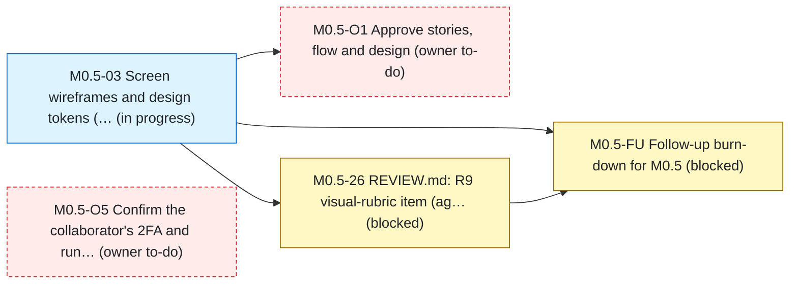
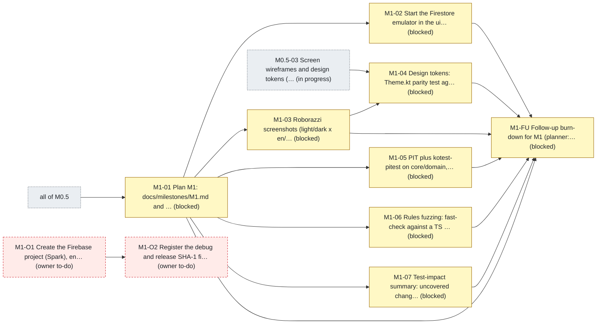

# Listicles status detail

Milestones, their tasks, what each open task waits on, and every blocker, generated from `docs/tasks.toml` and the open PRs and issues. The picture on the front page (`status.svg`) shows the same state. Status words: **done**, **ready** (all dependencies met), **in progress** (an open PR names the task), **blocked** (unmet dependencies or a `blocked` label), **owner to-do** (needs the owner).

## Overview

| Milestone | Name | Done | Open |
|---|---|---|---|
| M0 | Foundation and process | 28/28 (100%) | 0 |
| M0.5 | Product design and guardrails | 28/33 (84%) | 5 |
| M1 | Accounts and households | 0/10 (0%) | 10 |
| M2 | Inventory lists | not planned yet | 0 |
| M3 | Packing rules (domain) | not planned yet | 0 |
| M4 | Packing templates and trips | not planned yet | 0 |
| M5 | Barcode scanning | not planned yet | 0 |
| M6 | Release | not planned yet | 0 |

## M0 Foundation and process

Gradle skeleton, CI, hooks, review loop and agent setup, proven green on a hello-world app.

**Progress:** 28/28 done (100%), 0 open.

### Tasks

| Task | Title | Status | Depends on | Who | PR |
|---|---|---|---|---|---|
| M0-01 | Implementation plan (docs/PLAN.md), 4 review rounds | done | none | planner | [#1](https://github.com/bondo/listicles2/issues/1) |
| M0-02 | Gradle skeleton, version catalog, spotless/detekt/lint/Kover | done | M0-01 | implementer | [#1](https://github.com/bondo/listicles2/issues/1) |
| M0-03 | Batch 1&#58; verify/guards/hooks, Firebase emulator + deny tests, CI, Dependabot, PR template, CODEO… | done | M0-02 | implementer | [#1](https://github.com/bondo/listicles2/issues/1) |
| M0-04 | REVIEW.md and CLAUDE.md | done | M0-03 | implementer | [#1](https://github.com/bondo/listicles2/issues/1) |
| M0-05 | Agent setup&#58; roles.yaml, prompts, .claude settings and hooks, status line, handoff template, me… | done | M0-03 | implementer | [#1](https://github.com/bondo/listicles2/issues/1) |
| M0-06 | detekt 2.x vs 1.23 ADR, Kover on &#58;app, dark theme | done | M0-03 | implementer | [#1](https://github.com/bondo/listicles2/issues/1) |
| M0-07 | Prove the gates&#58; CI green on GitHub, a deliberately broken commit fails CI, then revert | done | M0-04, M0-05, M0-06, M0-O1 | implementer | [#1](https://github.com/bondo/listicles2/issues/1) |
| M0-08 | Branch-protection guide for the owner | done | M0-03 | implementer | [#34](https://github.com/bondo/listicles2/issues/34) |
| M0-09 | Orchestration process&#58; docs/ORCHESTRATION.md, state template, task graph + scripts/tasks.py | done | none | process | [#16](https://github.com/bondo/listicles2/issues/16) |
| M0-10 | Tooling session A&#58; run tasks.py and its tests in CI and verify.sh; CODEOWNERS for the process docs | done | none | implementer |  |
| M0-11 | Tooling session B&#58; align REVIEW.md, CLAUDE.md, agents/prompts, handoff template with ORCHESTR… | done | M0-04, M0-05, M0-10, M0-12 | implementer | [#80](https://github.com/bondo/listicles2/issues/80) |
| M0-12 | Follow-ups process&#58; docs/FOLLOW-UPS.md, tasks.py follow-up counts and burn-down checks | done | none | process | [#16](https://github.com/bondo/listicles2/issues/16) |
| M0-13 | Process and tooling review (#20)&#58; written review in docs/, prioritised proposals with effort an… | done | none | process | [#33](https://github.com/bondo/listicles2/issues/33) |
| M0-14 | Turn the proposals the owner adopts (M0-O11) into PR-sized tasks with dependencies; open follow… | done | M0-13, M0-O11 | planner |  |
| M0-15 | Lower the big-pr diff cap in ci.yml from 6000 to 1500 (D2) | done | M0-O11 | implementer | [#36](https://github.com/bondo/listicles2/issues/36) |
| M0-16 | Close follow-ups #21-#26 as by-design once branch protection is confirmed on (D1) | done | M0-O6 | process |  |
| M0-FU | Follow-up burn-down for M0 (close or re-defer each open follow-up targeting M0) | done | M0-01, M0-02, M0-03, M0-04, M0-05, M0-06, M0-07, M0-08, M0-09, M0-10, M0-11, M0-12, M0-13, M0-14, M0-15, M0-16 | implementer |  |
| M0-O1 | Add the big-pr label to PR #1 | done | none | owner |  |
| M0-O2 | Set the default branch to main | done | none | owner |  |
| M0-O3 | Make the repository public | done | none | owner |  |
| M0-O4 | Confirm the CODEOWNERS handle | done | M0-03 | owner |  |
| M0-O5 | Decide how the orchestration branch lands (merge into the PR #1 branch or a separate PR) | done | none | owner |  |
| M0-O6 | Turn on branch protection for main using the guide | done | M0-08, M0-O2 | owner |  |
| M0-O10 | Create the follow-up labels (follow-up, severity&#58;*, target&#58;*, area&#58;*, owner-ok) | done | none | owner |  |
| M0-O7 | Squash-merge PR #1 (M0) | done | M0-04, M0-05, M0-06, M0-07, M0-08, M0-O1, M0-O4, M0-O5 | owner | [#1](https://github.com/bondo/listicles2/issues/1) |
| M0-O8 | Retarget PR #16 to main after #1 merges, then squash-merge it | done | M0-O7, M0-09, M0-10, M0-11, M0-12, M0-FU | owner | [#16](https://github.com/bondo/listicles2/issues/16) |
| M0-O11 | Decide which proposals from the #20 process and tooling review to adopt | done | M0-13 | owner |  |
| M0-O9 | Create the GitHub labels orchestrator-state and owner-todo | done | none | owner |  |

### Open tasks and what blocks them

Nothing open.

## M0.5 Product design and guardrails

User stories, app flow, design tokens and the test, lint and review guardrails, signed off by the owner.

**Progress:** 28/33 done (84%), 5 open.

### Tasks

| Task | Title | Status | Depends on | Who | PR |
|---|---|---|---|---|---|
| M0.5-01 | User stories with acceptance criteria (docs/product/stories.md) | done | all of M0 | planner | [#94](https://github.com/bondo/listicles2/issues/94) |
| M0.5-02 | App-flow diagram (docs/product/flow.md, Mermaid) | done | M0.5-01 | planner | [#103](https://github.com/bondo/listicles2/issues/103) |
| M0.5-03 | Screen wireframes and design tokens (colors, type, spacing, dark mode) as an artifact | in progress | M0.5-01, M0.5-16 | planner | [#113](https://github.com/bondo/listicles2/issues/113) |
| M0.5-04 | App and repo name shortlist (#17)&#58; 5-8 candidates with Play Store, GitHub and domain availabilit… | done | all of M0 | planner | [#77](https://github.com/bondo/listicles2/issues/77) |
| M0.5-05 | guards.sh&#58; suppressions of new linters (noqa, type&#58; ignore, eslint-disable, &#64;ts-*, coverage, for… | done | M0-O11 | implementer | [#43](https://github.com/bondo/listicles2/issues/43) |
| M0.5-06 | CI&#58; shellcheck, actionlint, zizmor; SHA-pin actions; persist-credentials false (P2) | done | M0.5-05 | implementer | [#102](https://github.com/bondo/listicles2/issues/102) |
| M0.5-07 | ruff check (E,F,W,B,UP,SIM) and mypy (default) for scripts/, in verify.sh and CI (P3) | done | M0.5-05, M0-10 | implementer | [#79](https://github.com/bondo/listicles2/issues/79) |
| M0.5-08 | Firebase rules tests to strict TypeScript, ESLint strictTypeChecked and Prettier (P4, P5) | done | M0.5-05 | implementer | [#96](https://github.com/bondo/listicles2/issues/96) |
| M0.5-09 | Kotlin allWarningsAsErrors in all modules (P6) | done | M0-O11 | implementer | [#47](https://github.com/bondo/listicles2/issues/47) |
| M0.5-10 | licensee with the owner's allowlist (P8, D3)&#58; Apache-2.0, MIT, BSD-2-Clause, BSD-3-Clause; Goog… | done | M0.5-09 | implementer | [#84](https://github.com/bondo/listicles2/issues/84) |
| M0.5-11 | Konsist&#58; no floating point in core/domain, no raw colors/dp in UI; network-blocking JUnit extens… | done | M0-O11 | implementer | [#59](https://github.com/bondo/listicles2/issues/59) |
| M0.5-12 | Docs check&#58; relative links and backticked repo paths exist, planned paths allowlisted (P12) | done | M0.5-05, M0-11 | implementer | [#78](https://github.com/bondo/listicles2/issues/78) |
| M0.5-13 | Metrics&#58; orchestrator CSV comments per ORCHESTRATION 6 and scripts/agent_metrics.py to docs/age… | done | M0-O11 | implementer | [#58](https://github.com/bondo/listicles2/issues/58) |
| M0.5-14 | ORCHESTRATION.md retro changes&#58; delta review, one batch per PR, env pick, default deferral, early… | done | M0-O11 | process |  |
| M0.5-15 | Prompts&#58; design-reviewer role and checklist, PR-body refresh, delta review, environment pick (P… | done | M0-11, M0.5-14, M0.5-23 | implementer |  |
| M0.5-FU | Follow-up burn-down for M0.5 | blocked | M0.5-01, M0.5-02, M0.5-03, M0.5-04, M0.5-05, M0.5-06, M0.5-07, M0.5-08, M0.5-09, M0.5-10, M0.5-11, M0.5-12, M0.5-13, M0.5-14, M0.5-15, M0.5-16, M0.5-17, M0.5-18, M0.5-19, M0.5-20, M0.5-21, M0.5-22, M0.5-23, M0.5-24, M0.5-25, M0.5-26, M0.5-27 | implementer |  |
| M0.5-27 | Status picture on the README&#58; scripts render docs/tasks.toml plus PR and issue state to an SVG, a… | done | none | implementer | [#71](https://github.com/bondo/listicles2/issues/71) |
| M0.5-O1 | Approve stories, flow and design | owner to-do | M0.5-01, M0.5-02, M0.5-03 | owner |  |
| M0.5-O2 | Pick the app and repo name from the shortlist | done | M0.5-04 | owner | [#77](https://github.com/bondo/listicles2/issues/77) |
| M0.5-O3 | Log collaborator decisions D1-D7, create the five labels, check Actions settings (C5) | done | none | owner |  |
| M0.5-16 | COLLABORATING.md plus ORCHESTRATION, PLAN and orchestrator-state changes for the collaborator | done | M0.5-O3 | process | [#55](https://github.com/bondo/listicles2/issues/55) |
| M0.5-17 | Issue forms for feedback, ideas and questions, with a test that parses them | done | M0.5-O3 | implementer |  |
| M0.5-18 | scripts/collab_inbox.py&#58; digest of trusted collaborator activity since a time, from saved API JSON | done | M0.5-17 | implementer |  |
| M0.5-19 | Orchestrator and worker prompts&#58; inbox and accident-check wake steps, tiers, fenced text, label … | done | M0.5-16, M0.5-18 | implementer |  |
| M0.5-20 | docs/ANDROID-BEST-PRACTICES.md&#58; checklist from Google's Android guidance, enforced vs reviewer-c… | done | none | process | [#62](https://github.com/bondo/listicles2/issues/62) |
| M0.5-21 | Usage-limit handling&#58; ORCHESTRATION pause protocol, early warning, limit failures are not stalls… | done | M0.5-13 | process | [#63](https://github.com/bondo/listicles2/issues/63) |
| M0.5-22 | CLAUDE.md&#58; allow one reviewer session to review several small docs-only PRs (the pending bulle… | done | M0.5-21 | implementer | [#93](https://github.com/bondo/listicles2/issues/93) |
| M0.5-23 | docs/reviews/README.md&#58; review catalogue R1-R12, procedures, visual-quality rubric, meta-revie… | done | M0.5-21 | implementer |  |
| M0.5-24 | scripts/agent_metrics.py&#58; &#96;review&#96; row type (ledger of docs/reviews/README.md section 5), fai… | done | M0.5-23 | implementer |  |
| M0.5-25 | Orchestrator prompt&#58; R3 weekly digest step, ledger row after each review, R10 owner-todo per … | done | M0.5-19, M0.5-21, M0.5-23 | implementer |  |
| M0.5-26 | REVIEW.md&#58; R9 visual-rubric item (agent score below 3 is a minor finding) and R7 rules allow/… | blocked | M0.5-03, M0.5-15, M0.5-23 | implementer |  |
| M0.5-O4 | Collaborator invite sent and accepted | done | M0.5-19, M0.5-O3 | owner |  |
| M0.5-O5 | Confirm the collaborator's 2FA and run the live test | owner to-do | M0.5-O4 | owner |  |

### Open tasks and what blocks them

An arrow points from what a task waits on to the task. Dashed grey boxes are outside this milestone.

## M1 Accounts and households

Google sign-in, households, invite links, members and ownership, with rules tests.

**Progress:** 0/10 done (0%), 10 open.

### Tasks

| Task | Title | Status | Depends on | Who | PR |
|---|---|---|---|---|---|
| M1-01 | Plan M1&#58; docs/milestones/M1.md and PR-sized tasks in this file | blocked | all of M0.5 | planner |  |
| M1-02 | Start the Firestore emulator in the ui CI job (known gap R6-09), with the first Firebase-backed … | blocked | M1-01 | implementer |  |
| M1-03 | Roborazzi screenshots (light/dark x en/da), scripts/screenshots.sh, CI diff artifact, ATF and enabl… | blocked | M1-01 | implementer |  |
| M1-04 | Design tokens&#58; Theme.kt parity test against design/tokens.json and WCAG AA contrast test (P22) | blocked | M0.5-03, M1-03 | implementer |  |
| M1-05 | PIT plus kotest-pitest on core/domain, mutationThreshold 80 (P16) | blocked | M1-01 | implementer |  |
| M1-06 | Rules fuzzing&#58; fast-check against a TS reference model of PLAN 3.1 (P17) | blocked | M1-01, M0.5-08 | implementer |  |
| M1-07 | Test-impact summary&#58; uncovered changed lines to the step summary and verify.sh (P19) | blocked | M1-01 | implementer |  |
| M1-FU | Follow-up burn-down for M1 (planner&#58; add each new M1 task to depends_on) | blocked | M1-01, M1-02, M1-03, M1-04, M1-05, M1-06, M1-07 | implementer |  |
| M1-O1 | Create the Firebase project (Spark), enable Google sign-in and Firestore, add google-services.json … | owner to-do | all of M0, M0.5-O2 | owner |  |
| M1-O2 | Register the debug and release SHA-1 fingerprints in Firebase | owner to-do | M1-O1 | owner |  |

### Open tasks and what blocks them

An arrow points from what a task waits on to the task. Dashed grey boxes are outside this milestone.

## M2 Inventory lists

Lists and items with real-time sync, offline use, search, sort and filter, in English and Danish.

Not planned yet.

## M3 Packing rules (domain)

Scaling, per-person templates and merging as property-tested pure Kotlin.

Not planned yet.

## M4 Packing templates and trips

Template and rule editor, create a trip, trip checklist and one-off items.

Not planned yet.

## M5 Barcode scanning

Camera scanning, product lookup with a fallback to manual entry, duplicate warning.

Not planned yet.

## M6 Release

Signed APK on tag as a GitHub Release, and a disabled Play internal-track workflow.

Not planned yet.

## Blockers

- **owner to-do** [#119](https://github.com/bondo/listicles2/issues/119): &#91;owner&#93; M0.5-O5&#58; Confirm the collaborator 2FA and run the live test
- **owner to-do** [#120](https://github.com/bondo/listicles2/issues/120): &#91;owner&#93; Register a free limited-distribution Android developer account when available in Denmark
- **PR to merge** [#126](https://github.com/bondo/listicles2/issues/126): tooling&#58; roles, models and effort, context handoff stages, ci-triage and explorer frontmatter (ag…
- **task** M0.5-FU: waits on M0.5-03, M0.5-26
- **task** M0.5-O1: waits on M0.5-03
- **task** M0.5-26: waits on M0.5-03
